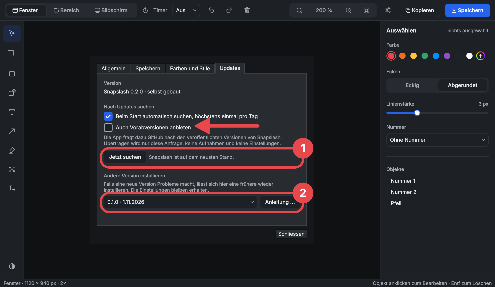

# Snapslash

Screenshots for instructions and documentation: capture **one window** with clean edges and transparent rounded corners, a region or a whole screen, then annotate it with frames, numbers, arrows and text, and copy or save it. Inspired by [WinSnap](https://www.ntwind.com/software/winsnap.html), for **Windows** and **Linux** (GNOME, Hyprland and other Wayland desktops). The user interface is in German and English.



> **Status:** [1.0](https://github.com/michaelpfister/ch-nsl-snap/releases) for Windows and Linux (GNOME, Hyprland and other Wayland desktops); macOS is planned.

## Features

**Capture**
- **Window, region or screen.** The screen freezes first, then you pick on the frozen picture, so menus, tooltips and hover states stay as they were.
- **Clean windows:** only the window itself. No shadow, no background and no neighbouring windows; rounded corners stay transparent. Add the shadow in your page's CSS instead.
- **Region** by two clicks or by dragging, with a magnifier and arrow keys to get it right to the pixel. A **screen** is one monitor, or all of them with Enter.
- **Timer:** a countdown of 3, 5 or 10 seconds before the freeze, for menus that close when you click elsewhere. It can sit in a corner instead of the middle, and ignore clicks.
- **Global hotkeys** on Windows (Print, Shift/Alt/Ctrl+Alt + Print, configurable). On Linux, the desktop's own key bindings run the command line.

**Video**
- **Record a window or a screen** as MP4 (H.264, 30 fps), with the mouse pointer and without sound, for short tutorials. Picked on the frozen screen like a screenshot, after a countdown of 3 seconds; up to 10 minutes.
- A small **indicator** shows the time and stops the recording; it never appears in the video on Windows.
- **Trim** the start and the end before saving, exact to the frame.

**Edit**
- **Frames** (square or rounded) and **numbered frames** that number themselves 1, 2, 3 and renumber when one is removed.
- **Arrows**, **text**, a **text marker**, and **pixelate or blur** for names and codes. The export holds only the obscured pixels.
- **Replace text**: overwrite a name in the screenshot with "Firstname Lastname", in the original's position.
- **Dim the background** around the frames, **crop**, and undo or redo every step.
- Colours from a palette, a colour wheel, a hex code or the eyedropper. The app remembers the styles you use.

**Keep**
- **Copy** to the clipboard, or **save** as PNG with a naming pattern (`{Datum}_{Zeit}_{Titel}`) into a default folder. HiDPI captures keep their scale in the PNG.
- **Series of captures:** each capture goes straight into the save folder; the strip "Letzte Aufnahmen" shows the recent ones as thumbnails and opens them in the editor.
- Runs in the **tray**, and starts captures from there.
- **Command line** for scripts and key bindings: `snapslash --capture-region` saves straight into the save folder and prints the path; `--open` shows the capture in the editor instead.
- **Updates and downgrades** from the GitHub releases (settings tab "Updates"). The portable Windows version installs any published version itself, older ones too, in case a new one misbehaves.

## Platforms

| | Window | Region, screen | Video | Updates |
|---|---|---|---|---|
| **Windows 10 (1903+) and 11**, x64 and ARM64 | ✓ | ✓ | window, screen | installs itself |
| **GNOME** on Wayland (46), with the Snapslash Shell extension | ✓ | ✓ | window, screen | shows the steps |
| **Hyprland** | ✓ | ✓ | window, screen | shows the steps (Nix) |
| **Sway** and other wlroots desktops | – | ✓ | screen | shows the steps |
| Other Wayland desktops (KDE, …), through the desktop portal | – | ✓ | planned | shows the steps |
| macOS | planned | planned | planned | |

Wayland does not let normal apps see other windows. On GNOME, a small Shell extension in this repository does the capture; on Hyprland the compositor's own protocols do. [docs/03-platform-capabilities.md](docs/03-platform-capabilities.md) has the details.

## Install

### Windows

1. Download `snapslash-<version>-windows-x64.zip` (or `-arm64`) from the [releases](https://github.com/michaelpfister/ch-nsl-snap/releases).
2. Unpack it to a folder you can write to, for example `C:\Users\<you>\Apps`, not `Program Files`. The app replaces this folder when it updates.
3. Start `Snapslash\snapslash.exe`. The program is not signed yet, so the first time Windows SmartScreen asks: "Weitere Informationen", then "Trotzdem ausführen".

Windows opens the Snipping Tool on the Print key by default; the app explains once how to switch that off.

### NixOS (Hyprland and others)

```bash
nix run github:michaelpfister/ch-nsl-snap
```

Or add the flake as an input and `inputs.snapslash.packages.${pkgs.system}.default` to `environment.systemPackages`. Key bindings for `hyprland.conf` are in [docs/07-development-setup.md](docs/07-development-setup.md#nixos-hyprland).

### Linux with GNOME (Ubuntu, Zorin OS, …)

Download `snapslash-<version>-linux-x86_64.AppImage` from the [latest release](https://github.com/michaelpfister/ch-nsl-snap/releases/latest) into a folder of your choice (for example `~/Apps`), tick "Allow executing file as program" in its properties, and start it. On its first start Snapslash sets itself up for your user, without administrator rights:

- a menu entry with its icon, and the command `snapslash` in `~/.local/bin` for key bindings and scripts;
- on GNOME, after you agree, the Shell extension Snapslash needs to pick windows and regions; then log out and in once.

Keep the file where it is: the menu entry points to it. To update, download the new AppImage and replace the file; the app sets itself up again (updating itself is planned, D-041). It runs on systems with glibc 2.35 or newer (Ubuntu 22.04, Zorin OS 17, Fedora 36 and later). Building from source: [docs/07-development-setup.md](docs/07-development-setup.md#installing-on-linux).

## Command line

```bash
snapslash --capture-region             # select, then save to the save folder; prints the path
snapslash --capture-window --open      # pick a window, then edit it
snapslash --capture-screen --delay 5   # count down 5 seconds first
snapslash --record-window              # record a video; the same command again stops and saves it
```

On Linux, videos need the graphics card's H.264 encoder (VA-API or NVENC); without one, Snapslash says so.

A running Snapslash does the capture itself, so key bindings never open a second window. `snapslash --help` lists all options. Exit code 0 means saved or opened, 1 cancelled, 2 failed.

## Development

C++20 with Qt 6.8 Widgets and CMake. The capture is platform-specific; the editor and everything else is shared.

```bash
cmake -S . -B build -G Ninja -DCMAKE_PREFIX_PATH=$HOME/Qt/6.8.3/gcc_64
cmake --build build && ctest --test-dir build
```

- [docs/07-development-setup.md](docs/07-development-setup.md): setting up Linux, NixOS and Windows, CI, and how to make a release.
- [docs/README.md](docs/README.md): architecture, decisions with their reasons, features, open questions.
- [AGENTS.md](AGENTS.md): the rules for changing the code.

## License

[MIT](LICENSE)
